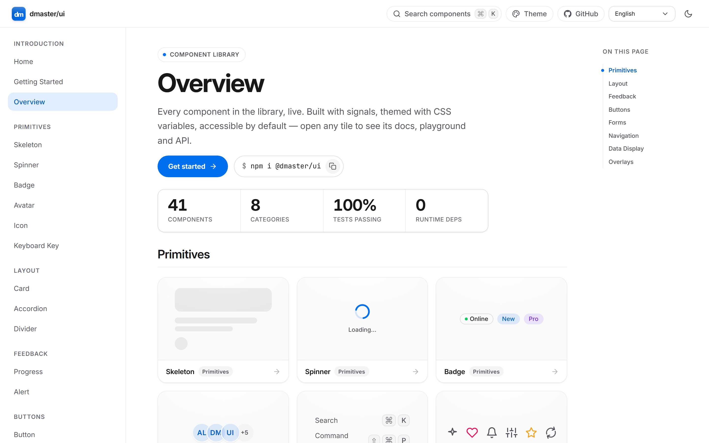

# @dmaster/ui

**Modern Angular UI components.** Standalone, signals-based, zoneless-ready, and fully themeable via CSS custom properties — with a clean, flat, pill-radius design language.

[](https://www.npmjs.com/package/@dmaster/ui)
[](https://www.npmjs.com/package/@dmaster/ui)
[](https://github.com/diegomn98/dmaster-ui-workspace/actions/workflows/ci.yml)
[](https://github.com/diegomn98/dmaster-ui/blob/main/LICENSE)
[](https://angular.dev)
[](https://dmasterui.com)
[](https://dmasterui.com)

**46 components · 3 languages (EN/ES/FR) in the docs · 0 third-party UI dependencies · 840+ tests**

**[→ Browse every component live at dmasterui.com/components](https://dmasterui.com/components)** — each tile is the real, interactive component, not a screenshot.

**[▶ Try it now on StackBlitz](https://stackblitz.com/github/diegomn98/dmaster-ui-workspace/tree/main/examples/starter)** — a minimal zoneless Angular app already wired up with the library; no install needed. (Source: [`examples/starter`](https://github.com/diegomn98/dmaster-ui-workspace/tree/main/examples/starter).)

<picture>
  <source media="(prefers-color-scheme: dark)" srcset="./docs-assets/overview-dark.png">
  <source media="(prefers-color-scheme: light)" srcset="./docs-assets/overview-light.png">
  
</picture>

---

## Why @dmaster/ui?

- **Modern Angular API** — `input()` / `output()` / `model()` signals, standalone components, no NgModules, no decorators
- **Zoneless-ready** — designed for `provideZonelessChangeDetection()` from day one
- **Flat, pill-radius design language** — flat colors, pill radii (`border-radius: 9999px` by default), elastic press scale, color × variant token system
- **Deeply themeable** — light / dark / auto via `data-dm-theme`; every visual decision is a `--dm-*` CSS custom property you can override
- **Accessible by default** — ARIA attributes on host elements, `:focus-visible` focus rings, touch targets ≥ 44px, `prefers-reduced-motion` support
- **CDK-powered overlays** — tooltip, popover, menu, dialog, drawer, toast and command palette built on `@angular/cdk`, no third-party overlay dependencies
- **Three density levels** — `compact`, `comfortable`, `spacious` via `data-dm-density`
- **Pay only for what you import** — one entry point per component (`@dmaster/ui/button`, `@dmaster/ui/menu`…), so a component used only in a lazy route stays out of your initial bundle; fully tree-shakeable: a button costs ~3.6 kB gzip, a card ~0.9 kB (see [Bundle size](#bundle-size))

---

## Installation

```bash
ng add @dmaster/ui
```

`ng add` installs `@angular/cdk`, registers the CDK overlay styles and wires the global stylesheet for you. Prefer manual setup?

```bash
npm install @dmaster/ui @angular/cdk
```

> **Peer dependencies:** `@angular/core`, `@angular/common`, `@angular/forms`, `@angular/cdk` (^20 || ^21 || ^22) and `rxjs`

---

## Quick start

**1. Add the global styles** in `styles.scss`:

```scss
@use '@dmaster/ui/styles/index';
```

No Sass in your build? Use the precompiled CSS instead — add it to the `styles` array in `angular.json`:

```json
"styles": ["node_modules/@dmaster/ui/styles/dmaster-ui.css", "src/styles.css"]
```

**2. Add CDK overlay styles** in `angular.json` (required for tooltip, popover, menu, dialog, drawer, toast, command):

```json
"styles": ["node_modules/@angular/cdk/overlay-prebuilt.css", "src/styles.scss"]
```

**3. Register the provider** (optional — sets default theme and density):

```ts
import { provideDmasterUI } from '@dmaster/ui/core';

bootstrapApplication(AppComponent, {
  providers: [provideDmasterUI({ theme: 'auto', density: 'comfortable' })],
});
```

**4. Import and use any component** — each one from its own entry point, `@dmaster/ui/<component>`:

```ts
import { DmButtonComponent } from '@dmaster/ui/button';
import { DmBadgeComponent } from '@dmaster/ui/badge';

@Component({
  imports: [DmButtonComponent, DmBadgeComponent],
  template: `
    <dm-button color="primary" variant="solid">Save</dm-button>
    <dm-badge color="success" variant="flat">Active</dm-badge>
  `,
})
export class MyComponent {}
```

Importing per component is what lets your bundler code-split the library: a component used only in a lazy route ships in that route's chunk, not in your initial bundle. The [Components](#components) tables list every import path.

---

## Entry points

Since 0.12.0 every component is published as its own **secondary entry point** (its own module in the package), named after the component: `@dmaster/ui/button`, `@dmaster/ui/menu`, `@dmaster/ui/toggle-group`… Bundlers split code by module, so with one entry point per component each lazy route only loads the components it actually uses. Before 0.12 the whole library was a single module, so anything a lazy route imported ended up in the initial bundle — even with `"sideEffects": false`.

| Import path               | What's in it                                                                                                                                      |
| ------------------------- | ------------------------------------------------------------------------------------------------------------------------------------------------- |
| `@dmaster/ui/<component>` | The component(s), their types, defaults token and `provide…Defaults()` helper — e.g. `DmSelectComponent`, `DmSelectItem`, `provideSelectDefaults` |
| `@dmaster/ui/core`        | Cross-cutting API: `provideDmasterUI`, `ThemeService`, `DensityService`, `ReducedMotionService`, shared types (`DmSize`, `DmTheme`…)              |
| `@dmaster/ui/icon`        | The `dm-icon` component, `DmIconRegistry` and `provideDmasterIcons()`                                                                             |
| `@dmaster/ui/icons`       | The curated set of ~53 outline SVG icons (`DM_ICONS` and one export per icon) — data, not a component                                             |
| `@dmaster/ui/styles/*`    | Sass sources and the precompiled `dmaster-ui.css`                                                                                                 |
| `@dmaster/ui/themes/*`    | Prebuilt color themes (one small CSS file each)                                                                                                   |

**`icon` vs `icons`.** They are two different entry points that work together: `@dmaster/ui/icon` is the component that draws an icon (by font ligature, registered name or projected `<svg>`); `@dmaster/ui/icons` is an optional set of SVG drawings you can register with it. An app that only uses font icons never imports `@dmaster/ui/icons`.

```ts
import { DmIconComponent, provideDmasterIcons } from '@dmaster/ui/icon'; // the component + registry
import { DM_ICONS } from '@dmaster/ui/icons'; // the curated SVG set
```

**Overlays share the CDK dialog symbols.** `DIALOG_DATA` and `DialogRef` are re-exported by both `@dmaster/ui/dialog` and `@dmaster/ui/drawer` (they're the same `@angular/cdk/dialog` symbols), so import them from whichever service you use.

### The root `@dmaster/ui` import is deprecated

`import { … } from '@dmaster/ui'` **still works** in 0.12 — the root entry point re-exports every component entry point, so nothing breaks when you upgrade. It is **deprecated** and will be **removed in a future version**. Its symbols aren't individually marked `@deprecated`, so your editor won't flag them: plan the switch now.

Code-splitting already works through the root import too: it only re-exports the side-effect-free entry points, so the bundler drops what you don't use and splits the rest per route. Measured on a real Angular 22 app that uses 18 of the components, upgrading from 0.11 moved 10 of them (toggle group, checkbox, switch, progress, search field, form field…) out of the initial bundle, with root and per-component imports alike. Migrate anyway: the root import is deprecated and will be removed.

### Migration guide

Replace each root import with one import per entry point. The entry point is the component's name (the folder in the [Components](#components) tables); providers, services and shared types come from `@dmaster/ui/core`.

```ts
// Before (deprecated)
import {
  provideDmasterUI,
  ThemeService,
  DmButtonComponent,
  DmSelectComponent,
  DmSelectItem,
  DmToggleComponent,
  DmToggleGroupComponent,
  DmDialogService,
  DialogRef,
} from '@dmaster/ui';

// After
import { provideDmasterUI, ThemeService } from '@dmaster/ui/core';
import { DmButtonComponent } from '@dmaster/ui/button';
import { DmSelectComponent, DmSelectItem } from '@dmaster/ui/select';
import { DmToggleComponent, DmToggleGroupComponent } from '@dmaster/ui/toggle-group';
import { DialogRef, DmDialogService } from '@dmaster/ui/dialog';
```

Every composite lives with its parts (`DmTabsComponent`, `DmTabComponent` and `DmTabPanelComponent` all come from `@dmaster/ui/tabs`; `DmFormFieldComponent` and `DmInputDirective` from `@dmaster/ui/form-field`). Styles (`@dmaster/ui/styles/*`), themes (`@dmaster/ui/themes/*`) and `@dmaster/ui/icons` are unchanged. To stop new root imports creeping back in, add an ESLint rule:

```js
// eslint.config.js
rules: {
  'no-restricted-imports': ['error', {
    paths: [{ name: '@dmaster/ui', message: "Import from the component's entry point, e.g. '@dmaster/ui/button'." }],
  }],
}
```

---

## Engineering & quality gates

Every pull request clears the same automated bar before it can merge — these run on CI, not on trust:

- **Accessibility is a gate, not a claim** — [axe-core](https://github.com/dequelabs/axe-core) (WCAG 2.1 A + AA) scans every prerendered docs page in **both light and dark themes**, plus every opened overlay. Zero violations required. ([details](#accessibility))
- **Visual regression** — every route is screenshotted in light + dark and pixel-diffed against committed baselines, inside a **pinned Playwright container** so rendering is deterministic across machines and CI.
- **Real-consumer integration** — the library is packed with `npm pack` and installed into a separate, isolated Angular app (`examples/starter`) that builds against the **published tarball** — catching exports-map, peer-dependency and type-resolution breakage the monorepo (whose paths point at source) never sees.
- **SSR safety** — the [docs site](https://dmasterui.com) is fully statically prerendered on every build, so any component that reaches for a browser-only global fails CI immediately.
- **Package hygiene** — [publint](https://publint.dev) validates the published layout on every PR; releases go to npm with **signed [provenance](https://docs.npmjs.com/generating-provenance-statements)** (Sigstore attestation).
- **Tree-shake audit** — per-component gzip cost is measured through the exact linker + minify pipeline the Angular CLI applies to published libraries, not a naive bundle. Reproducible with `npm run size`. ([bundle table](#bundle-size))

The four CI jobs — build/test/lint/publint, integration, a11y and visual — run in parallel and must all be green to merge.

---

## Components

46 components across 8 categories. Every row links to its live docs page (playground, API table, a11y notes) and names the entry point to import it from (see [Entry points](#entry-points)).

### Primitives

| Component                                             | Import                 | Selector      | Highlights                                                                  |
| ----------------------------------------------------- | ---------------------- | ------------- | --------------------------------------------------------------------------- |
| [Skeleton](https://dmasterui.com/components/skeleton) | `@dmaster/ui/skeleton` | `dm-skeleton` | Shimmer placeholder, wave animation                                         |
| [Spinner](https://dmasterui.com/components/spinner)   | `@dmaster/ui/spinner`  | `dm-spinner`  | Animated indicator, 3 sizes                                                 |
| [Badge](https://dmasterui.com/components/badge)       | `@dmaster/ui/badge`    | `dm-badge`    | Static status label — 6 variants · 6 colors · dot, shadow, bordered         |
| [Chip](https://dmasterui.com/components/chip)         | `@dmaster/ui/chip`     | `dm-chip`     | Interactive: removable, filter/choice, action · `dm-chip-set` with keyboard |
| [Avatar](https://dmasterui.com/components/avatar)     | `@dmaster/ui/avatar`   | `dm-avatar`   | Image + fallback initials, 5 sizes                                          |
| [Keyboard Key](https://dmasterui.com/components/kbd)  | `@dmaster/ui/kbd`      | `dm-kbd`      | Named keys resolve to their symbol (⌘, ⇧…), content projection              |
| [Icon](https://dmasterui.com/components/icon)         | `@dmaster/ui/icon`     | `dm-icon`     | Font ligature, registered SVG, or projected `<svg>` — 3 modes, 1 primitive  |

### Layout

| Component                                               | Import                  | Selector       | Highlights                                    |
| ------------------------------------------------------- | ----------------------- | -------------- | --------------------------------------------- |
| [Card](https://dmasterui.com/components/card)           | `@dmaster/ui/card`      | `dm-card`      | Container queries, shadow variants            |
| [Accordion](https://dmasterui.com/components/accordion) | `@dmaster/ui/accordion` | `dm-accordion` | Animated, single/multiple open, keyboard nav  |
| [Divider](https://dmasterui.com/components/divider)     | `@dmaster/ui/divider`   | `dm-divider`   | Horizontal/vertical, optional projected label |

### Feedback

| Component                                             | Import                 | Selector      | Highlights                                               |
| ----------------------------------------------------- | ---------------------- | ------------- | -------------------------------------------------------- |
| [Progress](https://dmasterui.com/components/progress) | `@dmaster/ui/progress` | `dm-progress` | Determinate/indeterminate, striped, value label          |
| [Alert](https://dmasterui.com/components/alert)       | `@dmaster/ui/alert`    | `dm-alert`    | Color × variant, semantic icon, dismissible, action slot |

### Buttons

| Component                                                     | Import                     | Selector          | Highlights                                                                        |
| ------------------------------------------------------------- | -------------------------- | ----------------- | --------------------------------------------------------------------------------- |
| [Button](https://dmasterui.com/components/button)             | `@dmaster/ui/button`       | `dm-button`       | 7 variants · 6 colors · idle/loading/success/error states · live region           |
| [Button Group](https://dmasterui.com/components/button-group) | `@dmaster/ui/button-group` | `dm-button-group` | Attached bar with 1px seams, group-level color/variant/size cascade, split-button |
| [Copy Button](https://dmasterui.com/components/copy-button)   | `@dmaster/ui/copy-button`  | `dm-copy-button`  | Copies text with a copy→check flip · `dmCopyToClipboard` directive · SSR-safe     |

### Forms

| Component                                                     | Import                     | Selector                        | Highlights                                                                                                                                                                     |
| ------------------------------------------------------------- | -------------------------- | ------------------------------- | ------------------------------------------------------------------------------------------------------------------------------------------------------------------------------ |
| [Switch](https://dmasterui.com/components/switch)             | `@dmaster/ui/switch`       | `dm-switch`                     | ControlValueAccessor, 3 sizes                                                                                                                                                  |
| [Checkbox](https://dmasterui.com/components/checkbox)         | `@dmaster/ui/checkbox`     | `dm-checkbox`                   | ControlValueAccessor, indeterminate state                                                                                                                                      |
| [Radio Group](https://dmasterui.com/components/radio-group)   | `@dmaster/ui/radio-group`  | `dm-radio-group` + `dm-radio`   | ControlValueAccessor, horizontal/vertical                                                                                                                                      |
| [Select](https://dmasterui.com/components/select)             | `@dmaster/ui/select`       | `dm-select`                     | Single or multiple (chips), inline filter, groups, select-all, CVA — or **server-driven**: `loadFn` pages via rxResource, infinite scroll / load-more, debounced server search |
| [Autocomplete](https://dmasterui.com/components/autocomplete) | `@dmaster/ui/autocomplete` | `dm-autocomplete`               | Free-text input with filtered suggestions, `optionSelected` event, keyboard nav, CVA                                                                                           |
| [Search Field](https://dmasterui.com/components/search-field) | `@dmaster/ui/search-field` | `dm-search-field`               | Leading icon, clear button, Escape clears, Enter submits                                                                                                                       |
| [Date Picker](https://dmasterui.com/components/date-picker)   | `@dmaster/ui/date-picker`  | `dm-date-picker`                | Day→month→year calendar, `Intl`-only (no date library), reactive locale (`DM_DATE_LOCALE`)                                                                                     |
| [Color Picker](https://dmasterui.com/components/color-picker) | `@dmaster/ui/color-picker` | `dm-color-picker`               | Saturation/hue/alpha area, editable hex, swatches                                                                                                                              |
| [Slider](https://dmasterui.com/components/slider)             | `@dmaster/ui/slider`       | `dm-slider`                     | Pointer drag + full keyboard map, value bubble, marks                                                                                                                          |
| [Rating](https://dmasterui.com/components/rating)             | `@dmaster/ui/rating`       | `dm-rating`                     | Star rating, half stars, readonly fractional average, custom glyph, `role="slider"`, CVA                                                                                       |
| [Number Input](https://dmasterui.com/components/number-input) | `@dmaster/ui/number-input` | `dm-number-input`               | Spinbutton with ± controls, keyboard map, clamp/precision, `Intl` formatting, CVA                                                                                              |
| [OTP Input](https://dmasterui.com/components/otp)             | `@dmaster/ui/otp`          | `dm-otp`                        | One-time-code / PIN cells, 4 surface variants, group separators, paste distribution, CVA                                                                                       |
| [Toggle Group](https://dmasterui.com/components/toggle-group) | `@dmaster/ui/toggle-group` | `dm-toggle-group` + `dm-toggle` | Segmented control, single/multiple, radiogroup or aria-pressed, roving keyboard, CVA                                                                                           |
| [File Upload](https://dmasterui.com/components/file-upload)   | `@dmaster/ui/file-upload`  | `dm-file-upload`                | Drag-and-drop dropzone, thumbnails, per-file progress, accept/size/count validation                                                                                            |
| [Form Field](https://dmasterui.com/components/form-field)     | `@dmaster/ui/form-field`   | `dm-form-field` + `dmInput`     | Label, hint, error, wraps any native input/textarea/select                                                                                                                     |
| [Error](https://dmasterui.com/components/error-message)       | `@dmaster/ui/error`        | `dm-error`                      | Validation line, `role="alert"`, no built-in icon (project your own)                                                                                                           |

### Navigation

| Component                                                   | Import                    | Selector                                | Highlights                                             |
| ----------------------------------------------------------- | ------------------------- | --------------------------------------- | ------------------------------------------------------ |
| [Breadcrumbs](https://dmasterui.com/components/breadcrumbs) | `@dmaster/ui/breadcrumbs` | `dm-breadcrumbs` + `dm-breadcrumb-item` | Router-agnostic, collapsible                           |
| [Tabs](https://dmasterui.com/components/tabs)               | `@dmaster/ui/tabs`        | `dm-tabs` + `dm-tab` + `dm-tab-panel`   | 5 variants, sliding indicator, full-width, scroll-fade |
| [Pagination](https://dmasterui.com/components/pagination)   | `@dmaster/ui/pagination`  | `dm-pagination`                         | Windowed pager, two-way page binding                   |
| [Stepper](https://dmasterui.com/components/stepper)         | `@dmaster/ui/stepper`     | `dm-stepper` + `dm-step`                | Horizontal/vertical wizard, linear mode, step states   |

### Data Display

| Component                                                   | Import                    | Selector                           | Highlights                                                       |
| ----------------------------------------------------------- | ------------------------- | ---------------------------------- | ---------------------------------------------------------------- |
| [Table](https://dmasterui.com/components/table)             | `@dmaster/ui/table`       | `dm-table`                         | Search → sort → paginate pipeline, row selection, virtual scroll |
| [Tree](https://dmasterui.com/components/tree)               | `@dmaster/ui/tree`        | `dm-tree`                          | WAI-ARIA tree view, roving focus, single/multiple selection      |
| [Timeline](https://dmasterui.com/components/timeline)       | `@dmaster/ui/timeline`    | `dm-timeline` + `dm-timeline-item` | Vertical/horizontal events, states, custom markers, alternate    |
| [Empty state](https://dmasterui.com/components/empty-state) | `@dmaster/ui/empty-state` | `dm-empty-state`                   | Icon + title + description + actions, custom icon slot, 3 sizes  |

### Overlays (require CDK)

| Component                                           | Import                | Selector / Service    | Highlights                                        |
| --------------------------------------------------- | --------------------- | --------------------- | ------------------------------------------------- |
| [Tooltip](https://dmasterui.com/components/tooltip) | `@dmaster/ui/tooltip` | `dmTooltip` directive | 12 placements, open/close delay                   |
| [Popover](https://dmasterui.com/components/popover) | `@dmaster/ui/popover` | `dm-popover`          | Rich floating panel, arrow follows the real flip  |
| [Menu](https://dmasterui.com/components/menu)       | `@dmaster/ui/menu`    | `dm-menu`             | WAI-ARIA menu, `FocusKeyManager`, typeahead       |
| [Dialog](https://dmasterui.com/components/dialog)   | `@dmaster/ui/dialog`  | `DmDialogService`     | Typed data, typed return, backdrop click to close |
| [Drawer](https://dmasterui.com/components/drawer)   | `@dmaster/ui/drawer`  | `DmDrawerService`     | Slide-in panel over `cdk/dialog`                  |
| [Toast](https://dmasterui.com/components/toast)     | `@dmaster/ui/toast`   | `DmToastService`      | Queued notifications, signal-driven state         |
| [Command](https://dmasterui.com/components/command) | `@dmaster/ui/command` | `dm-command`          | ⌘K command palette, fuzzy filter                  |

---

## Theming

Everything is a **CSS custom property** — no Sass required to consume, no Tailwind
lock-in, no runtime engine. Theme state lives on `<html>` attributes
(`data-dm-theme`, `data-dm-density`), so it is SSR-safe and flips without a
flash. Start from a prebuilt theme, then customize across four levels — from a
one-line accent swap to a full custom theme.

### Prebuilt themes

Nine curated palettes ship as tiny CSS files. Pick one at install — no code:

```bash
ng add @dmaster/ui                 # prompts for a theme
ng add @dmaster/ui --theme=ocean   # or pass it directly
```

…or add it to `angular.json`, right after the base styles:

```jsonc
"styles": [
  "node_modules/@angular/cdk/overlay-prebuilt.css",
  "node_modules/@dmaster/ui/styles/dmaster-ui.css",
  "node_modules/@dmaster/ui/themes/ocean.css" // ← recolors the whole app
]
```

Available: `ocean` · `cobalt` · `iris` · `grape` · `rose` · `ember` · `sunset` ·
`forest` · `slate` (plus the built-in blue, which needs no file). Each recolors
the brand in **both** light and dark — the light/dark toggle keeps working — and
every label color is gated at WCAG AA.

### Custom theme — `ng generate`

Want your own? Scaffold one from a seed color — it writes the CSS (with every
knob commented in) and wires it into `angular.json`:

```bash
ng generate @dmaster/ui:theme brand --primary=#e11d48
# switchable named theme instead of a global recolor:
ng generate @dmaster/ui:theme midnight --named --scheme=dark
```

The default is a **global recolor** (`:root` + `[data-dm-theme='dark']`, so
light/dark keeps working). `--named` emits a `[data-dm-theme='<name>']` block and
prints the [`provideDmasterUI`](#3-custom-named-themes) line to register it. Or
just override a token by hand:

### 1. Override a token — the whole family cascades

Every visual decision is a `--dm-*` token, and each semantic color's family is
**derived from its base**: the soft fill (`-subtle`) via `color-mix()`, and the
hover shade (`-hover`) and tinted-text shade (`-text`) via OKLCH relative color
syntax at a fixed, calibrated lightness. **Changing one base color re-themes
everything that uses it** — fills, hovers, tint text, rings:

```scss
:root {
  --dm-primary: #7c3aed; /* hover, -subtle, -text and rings all re-derive */
  --dm-radius-full: 0.5rem; /* rectangular controls instead of pills */
  --dm-duration-base: 100ms; /* faster animations everywhere */
}
```

Because the derived shades sit at a **fixed OKLCH lightness** (and WCAG contrast
is dominated by lightness), the derived text keeps its ≥4.5:1 ratio over its
tint for arbitrary brand colors — a mid-tone orange, a teal, a crimson all come
out AA out of the box.

> Only `-fg` (the label over **solid** fills, usually white) stays explicit: if
> your brand color is very light, also set `--dm-<color>-fg` to a dark value —
> or register the palette as a named theme (below).

### 2. Light / dark / auto

```ts
provideDmasterUI({ theme: 'auto' }); // follows prefers-color-scheme, tracks OS live
```

```ts
inject(ThemeService).setTheme('dark'); // or 'light' | 'auto'
inject(ThemeService).toggle(); // flip the active scheme
```

### 3. Custom named themes

Register any number of named themes and switch between them at runtime. The name
is stamped on `<html data-dm-theme="…">`; you author the matching CSS block:

```ts
provideDmasterUI({
  themes: {
    midnight: { scheme: 'dark', label: 'Midnight' },
    sand: { scheme: 'light', label: 'Sand' },
  },
});
```

```scss
[data-dm-theme='midnight'] {
  color-scheme: dark;
  --dm-bg: #0a0a12;
  --dm-primary: #8b5cf6;
  /* …only the tokens you want to change; the rest inherit the dark defaults */
}
```

```ts
const themes = inject(ThemeService);
themes.setTheme('midnight'); // apply
themes.themes(); // [{ name, scheme, label }] — build a picker
themes.scheme(); // 'dark' — the active theme's base scheme
```

### 4. Restyle a single component or a subtree

Because tokens are plain CSS custom properties, **scoping an override to an
element or a subtree re-themes only what's inside it** — no global change, no
component API needed:

```css
/* every switch in the app turns green — components read the semantic tokens */
dm-switch {
  --dm-primary: var(--dm-success);
}

/* just this section and everything under it */
.pricing {
  --dm-primary: #0ea5e9;
  --dm-radius-lg: 0;
}
```

On top of that, **every component exposes its own `--dm-<component>-*` design
tokens** (~300 across the library) for the decisions the semantic set doesn't
cover — surface, radius, heights, part-specific knobs:

```css
/* squarer, taller buttons app-wide — without touching the global radius scale */
:root {
  --dm-button-radius: 0.5rem;
  --dm-button-height: 3rem;
}

/* or one part of one component */
.data-panel {
  --dm-table-header-bg: var(--dm-bg-muted);
  --dm-switch-track-bg-checked: var(--dm-success);
}
```

Each component folder's `README.md` documents its tokens in a **Design tokens**
table.

> **Overlays** (tooltip, menu, dialog, drawer, toast, select, command) render at
> the document root via the Angular CDK, so a **global** override or a named
> theme (both applied on `<html>`) reaches them, but a **subtree** override does
> not. For a scoped theme inside a dialog or drawer, pass your theme class via
> `panelClass`:
>
> ```ts
> this.dialog.open(CheckoutComponent, { panelClass: 'brand-theme' });
> ```

### Density

Three density scales adjust control heights and spacing globally:

```ts
provideDmasterUI({ density: 'compact' }); // 'compact' | 'comfortable' | 'spacious'
```

---

## SSR / prerendering

The library is server-safe: no component or service touches `window`, `localStorage` or browser-only APIs at construction time — `matchMedia` is feature-detected through Angular's `DOCUMENT`, and overlays only open on user interaction. The [docs site](https://dmasterui.com) itself is fully statically prerendered with `@angular/ssr` as a permanent smoke test.

---

## Accessibility

Accessibility isn't a checkbox here — it's a gate. Every prerendered docs page (which exercises every component and variant) is scanned with [**axe-core**](https://github.com/dequelabs/axe-core) for **WCAG 2.1 Level A + AA** compliance, in **both light and dark themes**, plus every overlay opened — and the suite must be **green on every pull request**.

Concretely, components ship with: semantic roles and ARIA wired on the host, full keyboard support (roving focus, typeahead, focus traps in overlays), visible `:focus-visible` rings, ≥44px touch targets, `prefers-reduced-motion` honored, and a color system where every text/fill pair — including the vivid `flat` / `light` / `faded` variants — clears the 4.5:1 contrast ratio in both themes. Icon-only `dm-button`s take an `ariaLabel`; form controls forward validity through `aria-describedby` to `dm-error`.

Run it yourself against the prerendered build:

```bash
npm run build:app && npm run test:a11y
```

---

## Bundle size

Fully tree-shakeable, and **code-split per component**: every component is its own entry point, so your app only pays for the components it imports — and a component used only in a lazy route is paid for when that route loads, not at startup. Measured with the same pipeline the Angular CLI applies to published libraries (linker + minify + gzip, `@angular/*` and `rxjs` excluded):

| Import (whole entry point)          | Gzip     |
| ----------------------------------- | -------- |
| `@dmaster/ui/card`                  | ~0.9 kB  |
| `@dmaster/ui/badge`                 | ~1.4 kB  |
| `@dmaster/ui/button`                | ~3.6 kB  |
| `@dmaster/ui/select`                | ~10.7 kB |
| `@dmaster/ui/table`                 | ~18.9 kB |
| `@dmaster/ui/core`                  | ~1.0 kB  |
| **Entire library** (46), one bundle | ~119 kB  |
| Global CSS (tokens+reset)           | ~4.9 kB  |

The entire-library figure assumes every component lands in a single bundle. Its minified size is the same as in 0.11 (~633 kB), but split into one module per component it gzips about 9 kB worse than the old single module did. Real apps don't hit that case: they import some components and lazy-load others, and each of those got slightly smaller.

`npm run size` reproduces the full per-entry-point table. It also checks code-splitting with a synthetic app that loads `dm-button` at startup and `dm-checkbox` only in a lazy chunk: the checkbox stays in the lazy chunk through the subpaths and through the deprecated root import alike (with 0.11's single module it landed in the initial bundle).

---

## Who is this for?

@dmaster/ui is a good fit for:

- **SaaS dashboards** — tables, forms, overlays, and toasts out of the box
- **Admin panels** — dense layouts with consistent design tokens and three density modes
- **Component-library starters** — use as a base or reference architecture for signals-based Angular components
- **Teams migrating to zoneless Angular** — built for `provideZonelessChangeDetection()` from day one

---

## Compared to other Angular libraries

There's no shortage of component libraries in the Angular ecosystem. Here's how @dmaster/ui differs from the ones you're most likely evaluating alongside it — read this as "different tradeoffs," not "objectively better":

|                     | **@dmaster/ui**                                                  | Angular Material                                   | PrimeNG                                      | Taiga UI                                 | Spartan · ng-primitives                                                  |
| ------------------- | ---------------------------------------------------------------- | -------------------------------------------------- | -------------------------------------------- | ---------------------------------------- | ------------------------------------------------------------------------ |
| **API style**       | `input()`/`output()`/`model()` signals, standalone, no NgModules | Mix of legacy + newer APIs, NgModule-based         | NgModule + standalone hybrid                 | Signals, standalone                      | Signals, standalone                                                      |
| **What you get**    | Pre-styled components, own flat/pill design language             | Pre-styled components (Material Design)            | Pre-styled components, several theme presets | Pre-styled components, own design system | **Unstyled primitives** — copy-paste styled blocks you own, shadcn-style |
| **Theming**         | CSS custom properties only, no runtime engine                    | Sass theming API + Material 3 design tokens        | Runtime theme switcher + design tokens       | CSS custom properties                    | Tailwind-based, per-component                                            |
| **Component count** | 46                                                               | Comprehensive Material Design set (CDK + Material) | Very large surface area                      | 130+ (their own count)                   | 55+ primitives (their own count)                                         |
| **Zoneless**        | Built for it from day one                                        | Supported                                          | Supported                                    | Supported                                | Supported                                                                |
| **Install model**   | `ng add`, then import & use                                      | `ng add`, then import & use                        | Install & import                             | Install & import                         | CLI **copies component source into your repo**                           |

If you want a batteries-included, opinionated kit you install and start using immediately — that's @dmaster/ui, Angular Material, PrimeNG or Taiga UI, and the choice between them comes down to design language and API generation. If you want unstyled, accessible primitives you fully own the markup and CSS for, Spartan/ng-primitives is the better starting point.

---

## Contributing

Issues and PRs are welcome on [GitHub](https://github.com/diegomn98/dmaster-ui).

---

## License

MIT © [Diego Maestro](https://github.com/diegomn98)
